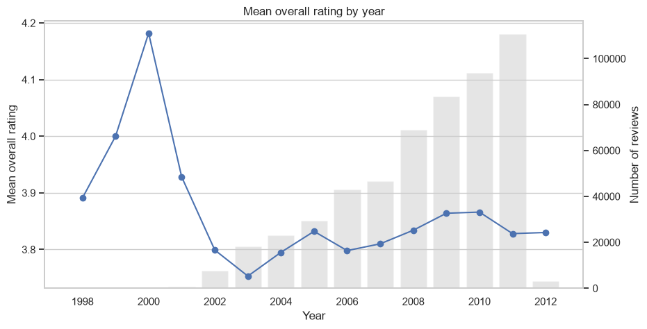
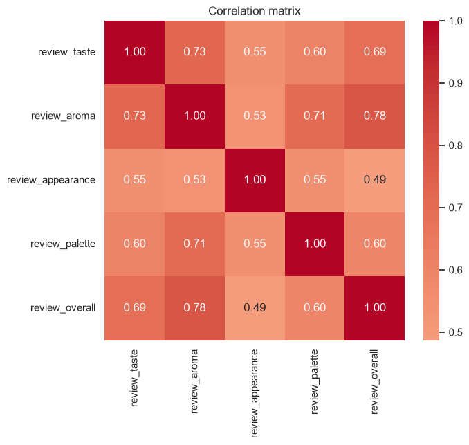
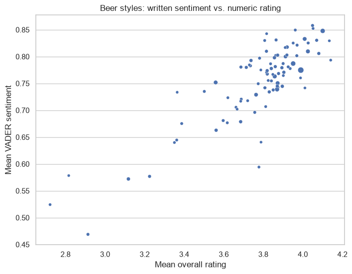

# Beer Reviews: Rankings, Rating Drivers, and Sentiment Analysis

Analysis of about 529,000 beer reviews (1998 to 2012) to find the strongest breweries, the highest-rated years, the factors that drive ratings, the best beers to recommend, and the favorite styles in written reviews.

**Tools:** Python, Pandas, NumPy, Seaborn / Matplotlib, scikit-learn, NLTK (VADER)

**Full analysis:** [`beer-analysis.ipynb`](beer-analysis.ipynb)

## Key results

- **Strongest beers:** Brewer 6513 (Schorschbräu) averages 24.7% ABV, driven by extreme releases such as a 57.7% beer. Brewer 396 is strongest on consistent output (10.2% across 52 beers)
- **Best year:** 2009 and 2010 are statistically tied for the highest ratings (about 3.87). The 2000 peak rests on only 33 reviews and is noise
- **Rating drivers:** Aroma matters most (correlation 0.78), then taste (0.69). Appearance and palette add almost nothing once those two are known
- **Recommended beers:** Citra DIPA, Cantillon Blåbær Lambik, and Heady Topper
- **Favorite style:** Gueuze comes first by rating, tied with Berliner Weissbier. Written sentiment and ratings agree strongly at the style level (Spearman = 0.74)







## Questions answered

| | Question |
|---|---|
| **Q1** | Which 3 breweries produce the strongest beers? |
| **Q2** | In which year did beers receive the highest ratings? |
| **Q3** | Which of taste, aroma, appearance, and palette matter most for the overall rating? |
| **Q4** | Which 3 beers would I recommend, based on the data? |
| **Q5** | Which style is the favorite in written reviews, and how does review sentiment compare to the overall score? |

## Approach

- **Cleaning and exploration:** duplicates, missing values, timestamps, and rating distributions
- **Q1 and Q2:** group-level averages with minimum-sample thresholds, plus confidence intervals for the year comparison
- **Q3:** correlation analysis cross-checked with a standardized regression
- **Q4:** beers ranked by average rating (minimum 100 reviews), cross-checked with an aroma/taste score
- **Q5:** VADER sentiment scoring of every review, compared with numeric ratings by style, with a check for review-length effects

## Limitations

- VADER uses a general-English lexicon, and its scores cluster near +1 and rise with review length, so styles were compared by rank
- Results depend on judgment calls: at least 5 beers per brewer, 100 reviews per beer, and 500 reviews per style
- Recommendations reflect the preferences of this reviewer population
- Breweries are identified by ID because the dataset has no brewery names

## Dataset

- **File:** `BeerDataScienceProject.tar.bz2`, a compressed CSV of beer reviews
- **Columns:** beer ABV, ID, brewer ID, name, and style, plus reviewer profile name, review text, timestamp, and ratings for overall, taste, aroma, appearance, and palette
- **Not included in this repository.** Place the file in the project folder before running

## How to run

1. Clone the repository and place `BeerDataScienceProject.tar.bz2` in the project folder
2. Install dependencies:

```
pip install -r requirements.txt
```

3. Open `beer-analysis.ipynb` in Jupyter and run all cells
4. The first run of the VADER scoring cell takes about 15 minutes. It saves `scored_reviews.pkl`, and later runs load that file in seconds

## Repository structure

```
├── beer-analysis.ipynb
├── requirements.txt
├── images/
└── README.md
```
